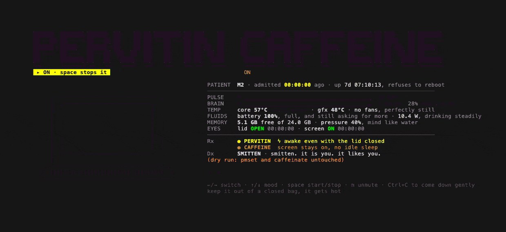

# Pervitin

Close the lid. Your agents keep working.

You have seen them: people crossing the office, the street, the train
platform with an open laptop held out like a tray, because closing it would
put the Mac to sleep and stop their coding agent mid-thought. Pervitin keeps
a Mac awake with the lid closed, so the laptop can go in the crook of an arm
like a normal object, and shows you a machine that is visibly on something
while it does.



It puts the Mac on two stimulants until Ctrl+C, terminal close or `kill`:

- **Pervitin** — `sudo pmset -a disablesleep 1`: no sleep at all, lid closed
  included.
- **Caffeine** — `caffeinate -dims`: the screen stays on and there is no idle
  sleep, but closing the lid still sleeps. Pervitin alone already blocks idle
  sleep, so with both on caffeine's contribution is the lit screen.

Sleep is given back when it exits, however it exits.

> [!WARNING]
> A Mac that cannot sleep with its lid closed gets hot in a bag. Pervitin
> asks for your sudo password to change the sleep setting, and keeps the
> sudo timestamp fresh while it runs so that it can always change it back.
> If it is killed with SIGKILL, run `pervitin off`.

## Install

macOS only. It has been tested on one machine, an M2 MacBook Air; on a Mac
whose sensors are named differently the chart may say "no thermometer".

```sh
brew tap bettiolo/pervitin https://github.com/bettiolo/pervitin
brew install --HEAD bettiolo/pervitin/pervitin
```

There are no tagged releases yet, so Homebrew builds the latest commit
(it installs Rust for the build). `brew upgrade --fetch-HEAD pervitin`
picks up newer commits. In a Brewfile:

```ruby
tap "bettiolo/pervitin", "https://github.com/bettiolo/pervitin"
brew "bettiolo/pervitin/pervitin", args: ["HEAD"]
```

Or from a checkout: `cargo install --path .`

## Use

```
pervitin          take both and animate until Ctrl+C / terminal close / kill
pervitin off      re-enable sleep (recovery after a SIGKILL or crash)
pervitin status   report whether sleep is currently disabled
pervitin help     keys, variables and the list of moods
```

| Key | What it does |
|---|---|
| left / right, tab | select PERVITIN or CAFFEINE |
| space, or a click on a title | start or stop that substance, for real |
| up / down | step through the moods |
| m | mute or unmute the lid sounds |
| Ctrl+C | give sleep back, then come down (a second Ctrl+C skips the animation) |

| Variable | What it does |
|---|---|
| `PERVITIN_DRY_RUN=1` | animate without touching pmset, sudo or caffeinate |
| `PERVITIN_NO_INTRO=1` | skip the intro and comedown animations |
| `PERVITIN_QUIET=1` | start muted |
| `PERVITIN_STAGE=name` | pin one mood (`pervitin help` lists them) |

The eyes follow the mouse where the mood allows: the terminal reports the
mouse while pervitin runs, so hold Shift to select text. It can be touched,
too: click an eye to poke it, click a key to press it, and wiggle the mouse
over the mouth to tickle.

## What you are looking at

Both names are big titles, each lit while its substance is working and dark
while it is not. Taking one plays a scene: a spinning capsule pops out of the
PERVITIN title and dives into the mouth; a mug flies out of the CAFFEINE
title, tips and pours. Stopping one brings it back up.

What is active decides which moods the laptop drifts through:

- **Neither:** a zen garden. It breathes slowly in soft colours and drifts
  between meditating, purring like a cat, a cup of (decaf) tea, a blanket, a
  sunbeam by day or stargazing at night, humming, and being quietly smitten
  with you.
- **Caffeine alone:** buzzed, jittery, chatty or manically productive.
- **Pervitin alone:** bloodshot, paranoid (about your busiest process),
  grinding its teeth, invincible in sunglasses and a crown, itching with
  crawling bugs, and hallucinating fish, ghosts and pink elephants.
- **Both:** all of the above plus a corrupting glitch, green matrix rain, a
  blue screen that keeps counting, a calm red-eyed HAL, vaporwave, an arcade
  cabinet, a 128 BPM disco and transcendence.

The stats are a medical chart, each line with a deadpan remark:

| Line | What it reads |
|---|---|
| PATIENT | time admitted, uptime |
| PULSE, BRAIN | CPU and GPU load, as an ECG and "brainwaves" |
| TEMP | CPU and GPU temperature, fans |
| FLUIDS | battery and power draw |
| MEMORY | free memory and memory pressure |
| EYES | the real lid and screen state, and for how long |
| Rx | what each substance is really doing to sleep |
| Dx | the mood, a diagnosis and the busiest process |

Every lid, screen, dose and sleep/wake change is logged with how long the
previous state lasted, and the log is printed again on exit. Closing the lid
on pervitin gets a spoken notice and an accelerating heartbeat; opening it
gets an "I saw everything" greeting.

The layout follows the terminal size: at 110 columns or more the chart sits
beside the laptop, otherwise below, and the titles and blank lines are
dropped when rows are scarce.

## How it works

A single Rust program with no dependencies; the few system calls it needs
are declared by hand.

- **Sensors** are read straight from the machine, without sudo or a helper
  program: temperatures and watts from the SMC, load and memory from the
  kernel, GPU load and battery from the I/O registry. Only the busiest
  process asks `ps`, because reading other users' processes needs root.
- **Cost:** drawing takes about half a percent of one core; the terminal
  spends several times that rendering it. It draws about seven frames a
  second, twice a second while its window is unfocused, and once a second
  while the lid is shut or the screen is off.
- **Safety:** Ctrl+C, SIGTERM, SIGHUP and a panic all restore sleep before
  anything else. `caffeinate` is tied to pervitin's process and stops with it.
- **Files:** the heartbeat sound is synthesized once into
  `~/.cache/pervitin/`. Nothing else is written.

## Development

```sh
cargo build --release
PERVITIN_DRY_RUN=1 target/release/pervitin   # no sudo, nothing changed
cargo test --release                          # checks the direct reads against ioreg and pmset
```

The demo is rendered by [vhs](https://github.com/charmbracelet/vhs) from
`docs/pervitin.tape`; the commands are at the top of that file.

## The name

It is named after Pervitin, the brand under which methamphetamine was sold
in Germany from 1938. This program is a joke about a laptop, not an
endorsement.

## License

[MIT](LICENSE) © Marco Bettiolo. Keep the copyright notice in copies and
substantial portions.
